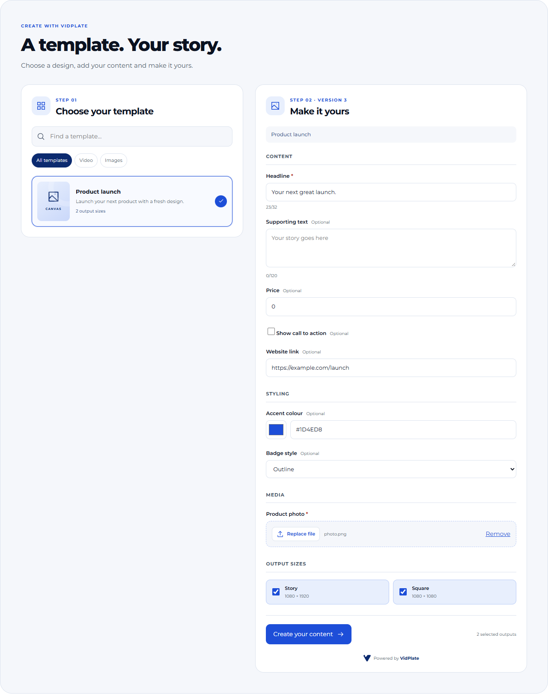
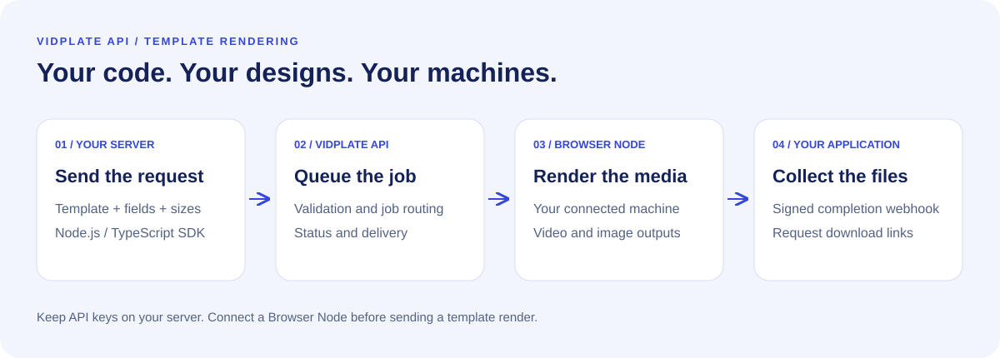
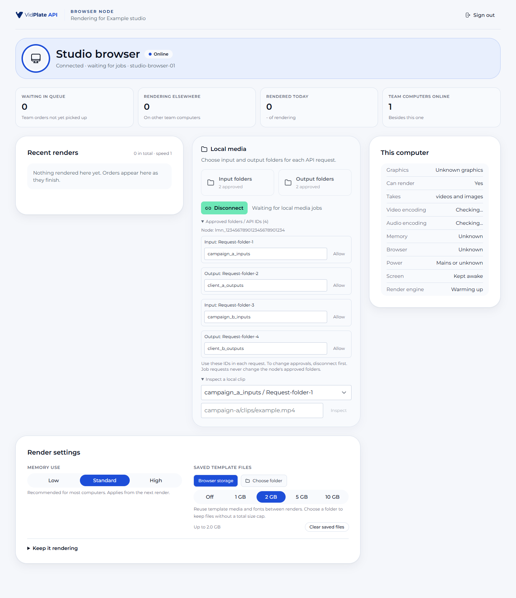

<picture>
  <source media="(prefers-color-scheme: dark)" srcset="docs/assets/vidplate-api-dark.svg">
  
</picture>

# @vidplate/api (Node.js / TypeScript)

**Install:** `npm install @vidplate/api`. Official SDK source, examples and releases. MIT licence.

A small, typed client for the VidPlate API (`https://api.vidplate.app/v1`). Every operation in the OpenAPI document is a method named after its operationId, generated from `front/src/public-site/pages/developers/docs/openapi.v1.json` by `sdks/generate.ts`.

- Bearer auth with a workspace key (`vpk_live_...` or `vpk_test_...`)
- Automatic `Idempotency-Key` (a random UUID) on every POST that accepts one, reused on retries
- Retries on 429 `too_many_requests` (honours `Retry-After`), and on 5xx or network errors for safe requests and requests with an Idempotency-Key. Quota 429s (`quota_exceeded`, `video_minutes_exceeded`, `static_outputs_exceeded`) are never retried.
- `VidPlateError` with `status`, `type`, `code`, `param`, `errors` and `requestId`
- `paginate()` async iterator, `waitForRender()` and `waitForMediaJob()`
- `webhooks.verify()` / `webhooks.constructEvent()` for the `VidPlate-Signature` header

Node 18 or newer (uses the global `fetch`). No runtime dependencies.

## Ready-made React order form

[React components and source](react/README.md) ? [Next.js example](examples/next-order-form/README.md) ? [Interactive demo](https://vidplate.app/developers/docs/order-form-kit)

Add a VidPlate-styled template picker and dynamic order form to your platform, with uploads, output sizes, render progress, downloads and **Powered by VidPlate** branding. The form reads the published template field contract and pins the version it submits.



Actual runnable component UI with fictional example data. Install the React kit with **`npm install @vidplate/react`**. Its backend example keeps the API key on your server. Follow its README to connect your own authentication and durable per-user access storage before a production integration. The Node SDK below remains a separate package.

## How it works



Design a template, fill its fields with JSON and render on your connected Browser Node. VidPlate handles the queue and signed completion webhooks. See the [quick start](https://vidplate.app/developers/docs/quick-start) and [Browser Node guide](https://vidplate.app/developers/browser-nodes).

<details>
<summary><strong>See the Browser Node interface</strong></summary>



Actual application UI captured with fictional demo data. The screenshot includes the separately documented [local-media beta](https://vidplate.app/developers/docs/browser-nodes#local-media). Local-media methods are not included in SDK 0.1.0; use the documented REST endpoints for that workflow. Standard template rendering uses the workflow above.

</details>

## Install from the repo

```sh
# Build once (TypeScript is a dev dependency)
git clone https://github.com/TomVidPlate/vidplate-node-sdk.git
cd vidplate-node-sdk
npm install
npm run build

# Then, from your project
npm install /path/to/vidplate-node-sdk
```

## Create a client

```ts
import { VidPlateClient, VidPlateError } from '@vidplate/api'

const vidplate = new VidPlateClient({
    apiKey: process.env.VIDPLATE_API_KEY!, // vpk_live_... or vpk_test_...
    // baseUrl: 'https://api.vidplate.app/v1',
    // maxRetries: 3,
    // timeoutMs: 60_000,
    // fetch: customFetch,
})
```

Method arguments: path parameters first (in path order), then the request body (POST) or the query (GET), then options (`idempotencyKey`, `headers`, `signal`, `timeoutMs`, `maxRetries`).

```ts
const render = await vidplate.getRender('rnd_6729c0a1b2c3d4e5f6a7b8f2')
const page = await vidplate.listRenders({ status: 'completed', limit: 50 })

// The same by operationId, with named arguments:
await vidplate.call('getRender', { path: { render_id: 'rnd_6729c0a1b2c3d4e5f6a7b8f2' } })
```

## Render a template and download the files

```ts
import { writeFile } from 'node:fs/promises'

const created = await vidplate.createRender(
    {
        template_id: 'tpl_6729c0a1b2c3d4e5f6a7b8c9',
        template_version: 4,
        fields: {
            HEADLINE: 'Now £19',
            ACCENT: '#0B6E4F',
            PRODUCT_SHOT: { upload_id: 'upl_6729c0a1b2c3d4e5f6a7b8e1' },
            SHOW_TERMS: false,
        },
        outputs: [{ format: 'feed_4x5' }, { format: 'story_9x16', image_format: 'jpg', image_quality: 85 }],
        external_id: 'sku-48213',
        metadata: { feed_run: '2026-11-02' },
    },
    { idempotencyKey: 'sku-48213-2026-11-02' }, // optional: one is generated when you leave it out
)

const render = await vidplate.waitForRender(created.id!, { intervalMs: 3000, timeoutMs: 10 * 60_000 })
if (render.status !== 'completed') throw new Error(`Render ended as ${render.status}`)

const outputs = await vidplate.listRenderOutputs(render.id!, { expires_in: 3600 })
for (const output of outputs.data ?? []) {
    const res = await fetch(output.download_url!) // a signed URL: no Authorization header
    await writeFile(output.file_name ?? `${output.id}.bin`, Buffer.from(await res.arrayBuffer()))
}
```

## Run a media job

```ts
const job = await vidplate.createMediaJob({
    operation: 'combine',
    inputs: [
        { upload_id: 'upl_6729c0a1b2c3d4e5f6a7b8e1', trim: { start_seconds: 1.5, end_seconds: 9 } },
        { output_id: 'out_6729c0a1b2c3d4e5f6a7b902' },
        { url: 'https://cdn.example.com/broll/beach.mp4', volume: 40 },
    ],
    combine: { transition: { type: 'crossfade', duration_seconds: 0.5 }, audio_crossfade: true },
    framing: { mode: 'fit', padding: { type: 'blur' } },
    outputs: [
        { aspect_ratio: '9:16', preset: 'tiktok' },
        { aspect_ratio: '16:9', resolution: '1080p', codec: 'h264', max_file_size_mb: 50 },
    ],
    external_reference: 'promo-17',
})

// Polls GET /media-jobs/{media_job_id}
const done = await vidplate.waitForMediaJob(job.id!)
if (done.status === 'completed') {
    const files = (await vidplate.listMediaJobOutputs(done.id!)) as { data?: Array<{ download_url?: string }> }
    console.log(files.data?.map((f) => f.download_url))
}
```

## Iterate a list

```ts
for await (const render of vidplate.paginate('listRenders', { status: 'failed', limit: 100 })) {
    console.log(render.id, render.status)
}
```

`paginate()` passes each page's `next_cursor` back as `starting_after` until `has_more` is false.

## Errors

```ts
try {
    await vidplate.getRender('rnd_missing')
} catch (err) {
    if (err instanceof VidPlateError) {
        console.log(err.status, err.type, err.code, err.message, err.requestId)
    }
    throw err
}
```

`status` is 0 when no response arrived (`type` is `connection_error` or `timeout`).

## Verify a webhook (Express)

Verify against the raw body, before any JSON parsing.

```ts
import express from 'express'
import { webhooks } from '@vidplate/api'

const app = express()

app.post('/vidplate/webhooks', express.raw({ type: 'application/json' }), (req, res) => {
    let event
    try {
        event = webhooks.constructEvent(req.body, req.header('VidPlate-Signature'), process.env.VIDPLATE_WEBHOOK_SECRET!)
    } catch {
        return res.status(400).send('Bad signature')
    }
    if (event.type === 'render.completed') {
        // Events carry IDs, never download URLs: fetch the outputs with listRenderOutputs.
    }
    res.sendStatus(200)
})
```

`webhooks.verify(rawBody, header, secret, { toleranceSeconds: 300 })` returns `{ valid: true, timestamp }` or `{ valid: false, reason }` without throwing. During a secret rotation the header carries two signatures, and `secret` may also be a list.

## Development

```sh
git clone https://github.com/TomVidPlate/vidplate-node-sdk.git
cd vidplate-node-sdk
npm test              # node --test test/smoke.test.ts (Node 22.18+ runs .ts directly; offline, mocked fetch)
npm run typecheck     # tsc --noEmit
npm run build         # tsc -> dist/
```

Do not edit `src/generated/operations.ts` by hand: run `node sdks/generate.ts` from the repo root (see `sdks/README.md`).

## Examples

Build the SDK with `npm ci && npm run build`, then run an example:

```sh
# Set VIDPLATE_API_KEY securely in your shell first.
node examples/list-templates.mjs
# Also set VIDPLATE_TEMPLATE_ID and VIDPLATE_FORMAT (a static template format key):
node examples/render-template.mjs
```

Never expose your workspace API key in a browser or commit it to GitHub. Examples use your account and allowances. A template render requires a connected Browser Node.

## Development

Use Node.js 22.18 or newer to run the TypeScript test suite. The built client supports Node.js 18 or newer.

```sh
npm ci
npm run prepublishOnly
npm pack --dry-run
```

Generated API operations are maintained in the VidPlate application's SDK generator. This repository contains the generated source for each SDK release. The 0.1.0 release uses API schema 2026.11.02; newer API capabilities are not implied until a matching SDK release is published.

See [CHANGELOG.md](CHANGELOG.md), [RELEASING.md](RELEASING.md) and [the API documentation](https://vidplate.app/developers/docs).

### Static image processing

Use `image_edit` or `image_collage` with `createMediaJob`. Resize/crop, rotate/flip, apply LUTs and photo adjustments, auto enhance without AI, add branding and export PNG/JPEG/WebP. See [the example](examples/static-image-processing.ts) and [API guide](https://vidplate.app/developers/docs/media-tools#static-images).
