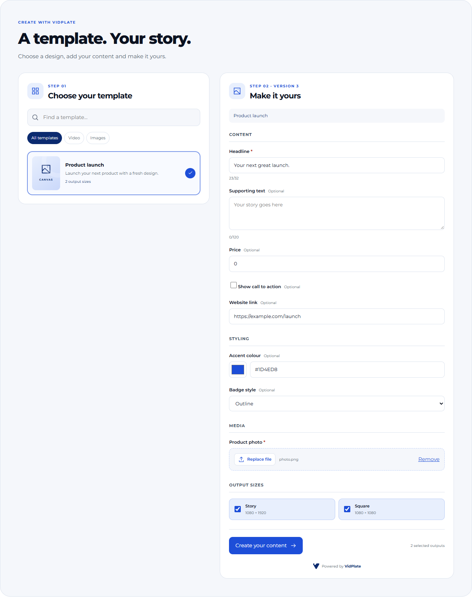

# VidPlate React order form kit

Reusable, VidPlate-styled UI for choosing a template and ordering rendered content. Uses Montserrat, the VidPlate API navy/blue palette and a visible **Powered by VidPlate** link. MIT licensed; bundled Montserrat uses the SIL Open Font License.

**Source preview:** version 0.1.0 is available as source and is not yet published to npm. Use the source kit or the [Next.js example](../examples/next-order-form/README.md). The Node SDK is a separate package and is not required by this kit.



Actual runnable component UI with fictional example data. [Try the interactive demo](https://vidplate.app/developers/docs/order-form-kit).

## React integration

```tsx
'use client'
import { VidPlateOrderBuilder, createHttpTransport } from '@vidplate/react'
import '@vidplate/react/styles.css'
import '@vidplate/react/fonts.css' // optional if your app already loads Montserrat

const transport = createHttpTransport({ basePath: '/api/vidplate' })

export default function CreateContent() {
  return <VidPlateOrderBuilder
    transport={transport}
    title='Create your next campaign.'
    onRender={render => console.log('Accepted order:', render.id)}
  />
}
```

The default heading is `h2` for embedding into an existing page. Use `headingLevel={1}` on a standalone page. `onRender` fires when the render is **accepted**, not when the files are complete. Keep `transport` stable (module scope or `useMemo`).

The HTTP transport talks to **your backend**, never directly to the VidPlate API. The package has no browser API-key prop. Do not place a secret in client code or a `NEXT_PUBLIC_` variable.

## Server integration

`@vidplate/react/server` exports `createOrderGateway` for Web Request/Response environments such as Next.js App Router. Supply your authenticated identity/tenant resolver and an ownership store:

```ts
import { createOrderGateway } from '@vidplate/react/server'

export const handle = createOrderGateway({
  async authorize(request) {
    const session = await yourApp.requireSession(request)
    return session ? {
      principal: session.userId,
      apiKey: await yourApp.getTenantVidPlateKey(session.tenantId),
      templateIds: await yourApp.allowedTemplateIds(session),
    } : null
  },
  store: yourSharedOwnershipStore,
  rateLimit: yourPerUserRateLimit,
})
```

Those `yourApp` functions are integration points, not exported helpers. The runnable Next example provides an explicit single-account login and process-local stores for development. Production must use your session system and shared durable storage/rate limits. The gateway fails closed for unknown upload/render IDs and scopes ownership to the authenticated user and tenant key. An omitted `templateIds` allows every template the tenant key can read; an empty array allows none.

## Included components

- `VidPlateOrderBuilder`: template list, search/type filter, generated form, uploads, output selection, status and downloads.
- `TemplatePicker`: controlled template cards with pagination and selection.
- `TemplateOrderForm`: version-pinned form generated from a `TemplateDefinition`.
- `RenderStatus`: polling, waiting-for-node messaging, retryable status refresh and refreshed download links.
- `PoweredByVidPlate`: attribution for custom compositions.

For custom compositions, wrap the pieces in `<div className="vp-order">` to provide scoped styles/tokens and include `PoweredByVidPlate`. You can implement `OrderTransport` instead of using the HTTP adapter if your platform uses other backend routes.

## Behaviour and limits

- Reads `GET /templates`, then `/templates/by-code/{code}/fields` and the **same version's** metadata/schema. Labels, defaults, sections, dropdown labels, colour patterns and text bounds come from the published contract. Template placeholders are hints, never supplied as answers. False/zero defaults are retained.
- Supports text, multiline text, URL, colour, dropdown, checkbox, number, image/video/audio/GLB uploads. Unsupported future field types block submission explicitly. Media accept/byte constraints are checked before upload; actual file formats, dimensions, duration and plan limits remain enforced by VidPlate. Browser MIME inference is a convenience, not file verification.
- Up to eight template output sizes and the version's duration choices. Uses template-default export settings. Advanced encoding, assets-library selection, variants, previews, arbitrary JSON fields and payments are not part of this first UI release.
- Search covers loaded templates; “Load more” fetches the next page. No template thumbnail URL is fabricated; the cards use decorative video/image graphics.
- Server validates the **pinned JSON Schema** again and checks that media uploads belong to this caller and template field. No arbitrary API proxy routes are exposed. Forms cannot override a tenant key or browser authentication.
- Retries of an unchanged submitted form reuse its idempotency key. Render failures/quotas are shown; the UI does not automatically resubmit a paid render. Component unmount aborts in-flight requests/uploads; unused uploads follow VidPlate's normal expiry.
- Polls up to 15 minutes; refresh can resume checking or renew download URLs. Integrate persistent order records and verified webhooks to support returning later. Closing the browser does not cancel a render already accepted.
- Use scoped keys with `templates:read`, `uploads:write`, `renders:read`, `renders:write`. Plan/storage/retention limits still apply.

## Styling

CSS is scoped to `.vp-order`. Override `--vp-order-blue`, `--vp-order-navy`, `--vp-order-radius` or other declared tokens on that wrapper. Self-hosted optional Montserrat is included; no remote font request is necessary. The base kit keeps “Powered by VidPlate” visible.

## Build and verify

```sh
npm install
npm test
```

The Node tests cover field semantics, Unicode bounds, version pinning, idempotency and cross-user access. Browser checks in the main repository exercise React UI and the runnable Next gateway against a disposable local API fixture; they do not create paid renders.
